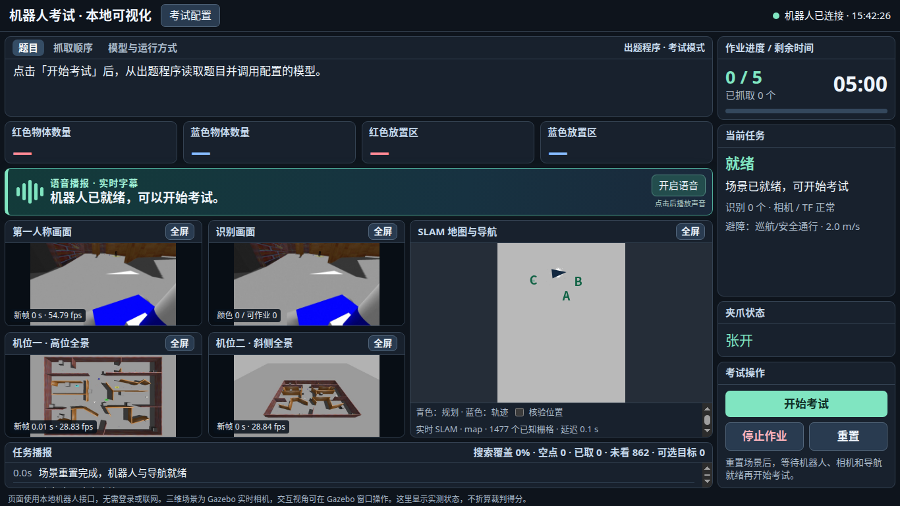

# 机器人比赛：使用、部署与算法说明

本目录是比赛程序的唯一运行工程，包含原 yzbot 小车与机械臂、v2 原始地形和贴图、Gazebo 仿真、ROS 2 导航与抓取、出题程序、可视化与启动脚本。使用原场景隔板；A/B/C 区利用现有隔板分隔，未重新复刻地图。

## 1. 一键启动和日常操作

将整个文件夹放在电脑或 U 盘的 Linux 文件系统中，在该文件夹打开终端：

```bash
./启动.sh
```

看到“全部启动就绪”后，打开 **http://127.0.0.1:8765/**。默认同时启动 Gazebo、原机器人、Nav2、MoveIt、SLAM、RViz，以及本地观察页面。桌面的“大模型机器人比赛”快捷方式指向这个工程。

1. 在页面选择裁判给定的映射规则、先搬颜色，应用配置。
2. 点击“开始考试”：从出题程序取题、调用配置模型、核验任务，再开始搜索、抓取和搬运。300 秒计时包含取题、解题与动作。 再次运行启动脚本会核对已加载源码摘要；源码或配置更新后会重启旧进程，避免继续使用旧版逻辑。
3. 需要中止时点击“停止作业”。重新开始前点击唯一的“重置”，等待场景、导航、SLAM 和相机恢复就绪。
4. 退出整套程序：

```bash
./停止.sh
```

常用独立入口：

```bash
./重置.sh
./开始考试.sh --rule 1 --first red
./打开RViz.sh
./第一人称.sh
./相机诊断.sh
```

`--rule` 支持 1/2/3，`--first` 支持 red/blue；必须按裁判要求设置，不能为了缩短路程改变颜色顺序。开始按钮变灰时先看页面状态；重置期间不可开始或再次重置。关闭 Gazebo 显示窗口不会自动停止物理服务，结束作业请用停止脚本。

## 2. 环境与完整迁移

推荐 Ubuntu 22.04 x86_64、ROS 2 Humble、Gazebo Classic。已有 Humble 使用原生方式；本机没有 Humble 时，启动器使用工程附带的 Ubuntu 22.04/Humble 离线容器环境。其他 ROS 版本不等于兼容环境，不能混用工作区。

```bash
./启动.sh --native       # 目标系统已经有 Humble 和依赖
./启动.sh --container    # 目标系统已有 Docker/dockerd/containerd/sudo
```

第一次编译或环境切换需要等待。源码、插件和运行库由启动器按当前目录重新构建；不要从另一系统单独复制 build/install。启动失败看终端及 `logs/startup-error.txt`，不能只看到 Gazebo 窗口就认为整套就绪。

主要依赖为 Gazebo、gazebo_ros2_control、MoveIt、Nav2、ros2_control、joint_trajectory_controller、joint_state_broadcaster、RViz2、CycloneDDS、OpenCV、NumPy、PyYAML、colcon、CMake 与编译工具。可复现的系统包清单在 `docker-build/Dockerfile`。已有依赖优先复用，无须重新下载同一环境。

GitHub仓库提供源码及资源，不包含大体积离线镜像；克隆仓库后可在已有Humble依赖的Ubuntu 22.04中使用原生方式运行。需要离线容器方式时，另行准备 `runtime/ros-humble-gazebo.tar.gz`；镜像构建清单位于 `docker-build/Dockerfile`。

迁移时复制整个工程，保留 `runtime/ros-humble-gazebo.tar.gz`、`ros_ws/src/`、`assets/`、`visualization/`、`runtime_fixes/` 和 `data/`。`.runtime/`、编译目录、日志、录像及本地模型缓存属于机器运行数据，不是源码提交内容。移动目录后运行 `./install-desktop-shortcut.sh` 更新快捷方式，换电脑后重新配置模型入口；本机通过不代表其他机器已完成性能验收。

U 盘建议使用 ext4 等支持执行权限和符号链接的文件系统。若文件管理器说 sh 没有可运行应用，在终端执行；权限丢失时：

```bash
chmod +x ./*.sh
./启动.sh
```

中文女声音频和播放组件一并位于 `assets/voice/`，迁移时随整个工程复制，不要漏掉该目录。声音播放无需安装中文语音引擎或 Python TTS 包，也不需要联网。复制后先执行 `python3 tools/check_voice_pack.py` 核对完整性，再用 `./语音试听.sh` 离线试听；运行整套系统后，在可视化页面点击“开启语音”。浏览器要求首次播放由用户点击开启，换电脑或新开页面需再次点击。

同步工程文件后，应在目标 Linux 系统中重新启动并检查相机、导航和语音；文件校验通过不等于已完成目标系统的整局考试验收。

## 3. 模型入口：本地 Qwen 与比赛官方模型

**Qwen 仅用于本机测试，正式比赛由组织方给定的模型解题。官方接口尚未实现时，不能宣称已完成正式模型接入。** 视觉识别使用相机和 OpenCV，不依赖 Qwen 是否具备图像能力。

本机已有的可选测试资源存于 `.runtime/local-model/`，启动器会自动发现。该缓存不加入 Git，也不随源码提交。其他电脑可使用已安装的 llama.cpp 服务：

```bash
./停止.sh
export YZBOT_LLAMA_SERVER=/绝对路径/llama-server
export YZBOT_QWEN_MODEL=/绝对路径/测试模型.gguf
./启动.sh
```

也可设置 `YZBOT_PRACTICE_LLM_URL` 指向兼容的现有服务。程序不自动下载模型，不附带官方模型或密钥。

### 官方模型对接契约

由接手者根据官方 SDK、模型和协议实现 `ros_ws/official_model_adapter.py`：

```python
def solve_task(*, question: str, context: dict, config: dict) -> dict:
    # 在这里调用官方模型，解析并校验题意；此函数不可直接控制机器人。
    return {"red": 2, "blue": 3, "red_zone": "B", "blue_zone": "C", "first": "red"}
```

示例只是内部输出格式，不是预设答案。必须根据每次传入的题目推理，字段须且只能有 red、blue、red_zone、blue_zone、first；总数为5，区域为A/B/C，顺序为red或blue。`model_adapter.py`负责隔离调用、超时和格式校验，异常会停止任务，不回退到测试模型。

保留出题程序，只替换解题模型：

```bash
./停止.sh
YZBOT_OFFICIAL_ADAPTER=official_model_adapter:solve_task ./启动.sh
```

官方平台直接推送题目时：

```bash
./停止.sh
YZBOT_TASK_MODE=official YZBOT_OFFICIAL_ADAPTER=official_model_adapter:solve_task ./启动.sh
```

通过 `POST /api/task` 提交 `{"question":"题目原文","context":{"rule":1,"first":"red"}}`，具体上下文字段需对照裁判协议。可选 `YZBOT_OFFICIAL_CONFIG` 指向私有JSON；容器内路径使用 `/opt/yzbot/ros_ws/official-config.json`。设置 `YZBOT_OFFICIAL_TIMEOUT` 控制调用超时，SDK网络调用也要自行设置超时。官方SDK应安装在实际运行的Humble环境，密钥不写入网页、README或Git。

出题程序是 `competition/platform/TMSCQtest_x86_x64.bin`。考试模式传入参数 `11470507`。该程序只产生数学题，不提供颜色映射与搬运顺序；映射及顺序必须来自裁判或正式平台。默认 `exam` 模式使用真实出题程序和本地测试适配器。

## 4. 可视化、RViz与数据链路

网页一屏显示第一人称、识别画面、两个比赛机位、SLAM地图、路线、任务进度、剩余时间与诊断。第一人称独立地址为 `/fpv`。用户提供的可视化JSON保留在 `visualization/`；默认页面已直接集成所需数据，不强制依赖外部Foxglove。

### 可视化界面在哪里，如何发给别人

| 内容 | 工程内位置 |
| --- | --- |
| 最新网页界面、布局和交互 | [`ros_ws/competition.html`](ros_ws/competition.html) |
| 相机、地图、任务状态及按钮接口 | [`ros_ws/competition_node.py`](ros_ws/competition_node.py) |
| 离线中文女声音频与播放器 | [`assets/voice/`](assets/voice/) |
| RViz、原可视化配置与渲染资源 | [`visualization/`](visualization/) |
| 整套系统启动入口 | [`启动.sh`](启动.sh) |

给别人使用时，发送整个仓库地址：**https://github.com/necx26/the-model-innocation**。单独发送 HTML 只能拿到界面代码；实时画面、识别结果和考试操作需要机器人后台接口，因此不能以双击 HTML 文件代替启动系统。

接收者在已具备第2节依赖的 Ubuntu 22.04 / ROS 2 Humble 系统中：

```bash
git clone https://github.com/necx26/the-model-innocation.git
cd the-model-innocation
# 首次运行前，按第3节配置已有测试模型或官方模型适配器。
./启动.sh --native
```

启动就绪后，在**运行本程序的电脑**浏览器打开 **http://127.0.0.1:8765/**。这个地址代表接收者自己的电脑，不是在线演示网站；当前后台仅监听本机。仓库不包含本机 Qwen 权重、私有模型配置或大型容器镜像，模型与部署环境须按第2、3节准备。需要桌面快捷方式时，在接收者自己的工程目录运行 `./install-desktop-shortcut.sh`，重新生成与该电脑目录匹配的入口。

下图是2026年10月20日15:42连接本地后台时的界面布局参考；截图早于本次语音及60Hz配置更新，当前文案与设置以源码为准：



RViz默认启用，显示真实ROS消息：

| 显示 | 数据 |
| --- | --- |
| 机器人模型 | `/robot_description`、`/tf`、`/tf_static` |
| 地图 | `/map` |
| 激光 | `/scan` |
| 规划路径 | `/competition/path` |
| 行驶轨迹 | `/competition/traveled_path` |
| 第一人称预览 | `/competition/rviz_image` |

参考坐标系是map，使用仿真时钟。规划路径在导航开始后产生，初始地图会随探索扩展。RViz小图是独立预览，不改变识别器原始输入。兼容入口和渲染资源保留在 `visualization/`；默认软件OpenGL，减少不同Mesa环境的兼容问题。

相机在Gazebo端压缩，经可靠JPEG话题传输；每帧结合相同图像时间戳的TF投影，避免运动时错位。界面显示新帧年龄与识别结果；启动器要求连续帧、对应TF、导航和控制器全部就绪。

## 5. 算法流程与工程创新点

流程：取题 → 模型解题及约束校验 → 观察与记忆 → 顺序约束调度 → 导航抵近 → 图像复核与抓取 → 送到指定区域 → 释放、退出与终检。

### 5.1 带负证据的语义记忆与顺路观察

不仅记住看到的红蓝目标，还区分已确认空点、已取位置与尚未看清的区域。空点需要三帧有效地面观察，同时检查实际视野、分辨率、静态遮挡和实时激光，避免把挡板后面误判为空。新物体观察可覆盖旧空点，取走一件不会把整个隔间标空。机械臂收好后，搬运途中继续识别其他目标，减少专门停下搜索。

历史相机轨迹形成按地图哈希隔离的观察热图，只建议去哪里观察，不创建本轮目标或替代当前图像确认。连续复核失败会回到覆盖搜索。可选赛前视觉采集：`./视觉经验采集.sh --side all --seconds 600`；采集不是考试成绩，使用前须符合赛方允许的准备范围。

### 5.2 顺序约束下的搬运调度与在线ETA

对已观察候选做不重复组合搜索，以可通行地图距离、转向、抓放耗时与失败惩罚估算总代价；颜色顺序是硬约束。每件完成后按实际耗时校准时间系数。即使保守预算认为不足，也尝试当前合法的已确认候选，避免最后阶段丢下已知目标转去盲搜。算法不保证未知地图的全局最优。

### 5.3 工作区触发的车臂协同抓取

目标需通过颜色、尺寸、紧凑外形、地面支撑及地图遮挡过滤，并以不同时间戳图像确认。近景按5厘米立方体投影八顶点拟合边框，校正单点投影偏差，拟合残差不合格时保留原估计。当前物体姿态沿地图坐标轴；车身可以斜向接近，手腕对齐方块边缘，减少额外转动车身。

目标进入机械臂工作区后，优先保持当前底盘位置和朝向，由肩、肘、腕协同伸向目标；不要求物体始终位于车头正前方。附近目标也会尝试沿当前朝向短距离直行进入可达区域，减少先转车身再伸臂的动作。 直达目标时一次驶入约25厘米的前方抓取区，取消先停在50厘米处再推进的常规步骤；沿导航路径进入可抓区域时可提前结束导航，跳过终点车身精对准。停稳后只要图像位置通过IK就直接伸臂，不为凑标称距离额外挪车。 行进途中用近景立方体投影拟合检查目标；位置偏差超过4.5厘米时提前取消旧抵近指令，以新图像位置完成剩余距离。近处物体过滤使用原底盘、轮子的地面占位，避免把收起机械臂所占的较大导航包络误用为地面遮挡。工作区筛选同时检查底盘外缘间距与隔板遮挡，实际停稳后重新核验图像及悬停、接触两处IK。无法安全伸到时才沿原导航流程调整底盘。这是受关节限位、自碰撞和隔板约束的多方向抓取，不是无限制的全向机械臂。 左右侧各约80°的专项实抓均通过：四帧相机定位后保持底盘姿态，末端伸向目标、夹取并抬升；抓取过程底盘位移分别约0.11、0.23毫米。专项测试单独记录在 `verification/side-grasp-diagnostic.json`，不计作整局限时验收；后方目前仅验证了IK和碰撞规划，尚未实抓。

抓取的伸臂与下降、放置的伸臂与下降、释放后的抬升与收臂分别合成为一次控制器轨迹。各段独立经过MoveIt碰撞规划，保留规划速度、加速度和端点停稳条件；接触下降使用0.85缩放，未提高模型关节极限。夹爪依据新鲜关节反馈确认到位，替代固定等待；闭爪遇阻只表示接触候选，仍须通过末端距离及物体真实抬升核验。状态接口记录各次规划、轨迹和夹爪耗时。 同题回归中，抓取与放置合计由88.03秒降至82.09秒（约6.7%）；整局230.1秒，五件终检合格。该对比为单轮测量，解题和导航波动需分开看，详见 `verification/arm-speed-comparison.json`。

刚完成的上下位姿IK预检只在底盘位移小于6毫米、偏航变化小于0.01弧度、目标变化小于3毫米且不超过2秒时复用；其余情况重新求解。复用IK后仍须执行轨迹碰撞规划。

实体身份仅在图像引导抵近后用于仿真接触及夹持核验，不为搜索提供隐藏目标坐标。使用Gazebo附着约束抬升，并确认真实物体高度变化；这不是实机摩擦抓取验收。失败后张爪、撤臂、重新观察，不盲冲。

### 5.4 联合选择落点、停靠侧与退出通道

A=(2,-6)、B=(5,-2.4)、C=(-6.5,-2)。在区内枚举落点与四个停靠侧，避开已经放入的货物，检查机械臂前方工作区、30厘米退出通道和退出后的转向空间。区内已有可达落点时直接停稳放置，不追求无意义的固定车头朝向。 同一停靠侧导航失败后改选其他朝向的可达侧，不重复沿被占用的一侧强行靠近。 修复后回放此前失败的同一道题，249.7秒完成红1→C、蓝4→B，五件终检合格、五次抓取，无抓取重试或换侧重抓；本次没有触发放置换侧分支，记录为 `verification/manipulation-recovery.json`。

几何筛选后仍验证悬停和释放IK；确有必要才调整底盘。厘米级轴向误差使用带碰撞检查的Nav2直行/后退修正，大位移交给路径导航。放下后返回预先验证的悬停姿态、收臂，向远离落点的方向退出。每次放置与任务结束均复核真实位置，防止物体被踢出后仍计分。

### 5.5 障碍车整段轨迹与车身包络校验

Move1沿前进方向前移2米，仍按2.4米线段往返；Move2保留原轨迹。运动插件使用运动学位姿更新，不能依靠物理碰撞自动停车，因此启动与场景配置时按完整扫掠包络检查墙体和原场景箱体，包含车身、车轮及立牌的水平范围。检查读取Gazebo保存状态中的模型位姿，避免忽略v2文件内保存状态对模型初始位姿的覆盖。Move1修复后最小车墙间距约0.669米；穿墙或不足4厘米额外余量的配置禁止启动。 Gazebo中连续30秒、599次采样覆盖完整往返，两辆车的实测位移跨度均约2.4米，车墙间距检查通过，记录为 `verification/patrol-runtime.json`。证据位于 `verification/patrol-wall-correction.json`。

### 5.6 停车包络与低矮货物语义避障

巡航上限2米/秒，实际速度由曲率、代价地图、碰撞预测与刹车距离共同限制。10Hz计算车身前方通道；侧墙不在直行通道内时不额外当作迎面障碍。结合里程计扣除本车运动、估计障碍接近速度，按传感器年龄、反应时间、1.2米/秒²制动能力和0.25米保留间距求允许速度。减速立即生效，恢复速率受限。

水平激光看不到低矮方块，因此把相机确认目标和已放货物补入语义点云代价图。Nav2碰撞检查始终开启；包络依赖测量和制动假设，不保证任意突发障碍的绝对安全。

### 5.7 跨轮状态隔离和故障监督

每次重置重新初始化本工程导航与SLAM，防止旧图残留造成绕路。等待地图、TF、服务和新代价地图位姿就绪后才开放开始。解除可能跨进程残留的夹持约束，避免复位时拉飞机器人。相机、时钟、TF、导航位置冻结时停止运动；原地转动不当作导航进展，异常时只允许有限、受碰撞检查的平移恢复。

定位过一次tf2 0.25.23锁顺序反转：项目内对相应版本使用锁外回调修复，不覆盖系统库。确定性回归和实际加载检查位于 `runtime_fixes/tf2/`、`verification/`。版本不匹配不加载该补丁。

转向参数做过同位置90°对照：1.0弧度/秒设置用时2.13秒，1.4设置用时2.57秒，后者没有收益，未采用。保留现有转向设置，不把单纯提高参数当作优化。记录在 `verification/heading-comparison.json`。

这些是有实现与实测依据的工程改进，不是强化学习训练成果，也不声称首次提出相应算法。

### 5.8 显卡渲染、采集与单屏显示

容器启动时优先接入当前系统已安装的NVIDIA驱动与设备，驱动库仅以只读方式绑定，不包含在工程或GitHub中；没有NVIDIA时使用现有DRI设备或软件渲染。`YZBOT_RENDERER=software ./启动.sh --container` 可指定软件兼容模式。驱动路径和版本按运行电脑自动探测。诊断见 `logs/graphics-config.json`，Gazebo目标帧率与实测值见 `logs/gazebo-render.json`。

`ros_ws/scene_config.json` 中的 Gazebo 显示、前置相机采集、两个固定机位采集及网页四路画面的目标刷新率统一为60Hz。网页每路只保留一个在途请求并等待图片解码，避免请求积压。前置分辨率960×540、两个全景机位640×360与JPEG质量95均保留。Gazebo Qt定时器存在毫秒取整，实际帧率会随显卡、系统负载与仿真速度波动；配置60Hz不代表每台电脑均能达到实测60帧。仿真时钟发布120Hz，里程计和机器人TF发布60Hz，使视觉定时器不再被原10Hz时钟限制；物理步长及运动限位保留原设置。地图与任务状态继续按各自节奏刷新，不加入高频图像轮询。

桌面布局将右侧进度、任务、夹爪和操作区贯穿整个内容高度，四路画面和地图同时可见。常用正文17—20像素，语音字幕19—24像素；已检查1920×1080、1366×768、1280×720、1024×600四种尺寸，长题目与所有模块均保留。更小屏幕采用上下排列。任务详情可悬停查看完整文本，日志可滚动。

语音区域始终显示简短任务字幕，点击“开启语音”后播放随包携带的普通话女声。使用晓晓女声，语气温柔轻快；开场、发现目标和完成阶段配合提示语、标点、语速与音高调整，让播报更自然。29段 MP3 共约0.66MiB，覆盖红蓝目标、A/B/C区搬运及主要动作阶段。音频通过本地接口读取，不再依赖浏览器的系统声音列表，避免英文系统选错声音或缺少中文发音导致乱读。

这是预先合成、随项目携带的阶段提示音频，不是运行时任意文本或自适应情感合成。具体数量、用时和详细异常由实时中文字幕与任务模块显示。播放只跟随实际任务阶段，切换阶段会取消旧声音；异步加载完成后也会检查是否已过期，关闭立即停止，不堆积调试播报。音频有完整性校验，缺文件会显示提示并保留字幕，不回退到英文声音。页面加载、开启及播放时会清除遗留的浏览器原生语音队列；字幕不再请求额外自动朗读。同一浏览器的比赛页面共享语音控制权，新页面开启后，其他比赛页面会自动关闭语音，避免重复出声。更新后应刷新旧比赛页面以加载新组件。双页面接管、旧原生语音清理及异步加载取消已验证，记录见 `verification/voice-overlap-checks.json`。语音不参与导航和机械臂控制。

独立检查与试听（不要求启动 Gazebo）：

```bash
python3 tools/check_voice_pack.py
./语音试听.sh
# 整套系统已经启动时，还可检查全部本地语音接口：
python3 tools/check_voice_pack.py --url http://127.0.0.1:8765
```

音频来源为微软 `zh-CN-XiaoxiaoNeural`，开发时通过 [edge-tts](https://github.com/rany2/edge-tts) 7.3.1 生成；运行时不调用该服务。该生成工具不支持自定义情感风格 SSML，本工程没有将音高调整称为情感模型。需要修改播报文案时，联网环境安装 `edge-tts==7.3.1` 后运行 `python3 tools/build_voice_pack.py`，再检查语音包；日常启动无需安装或执行生成工具。

同题完整回归253.6秒完成，五件终检合格；抓取与放置阶段合计从上一轮82.05秒降至72.79秒。整局用时没有显著改善，不将导航和解题波动归因于显示优化。性能实测见 `verification/performance-after.json`。本次语音更换不修改运动参数；声音解码、阶段切换、取消、断外网播放与界面布局检查另见 `verification/voice-checks.json`。

UI排版检查和截图位于 `verification/layout-checks.json` 与 `verification/layout-*.png`。

## 6. 完整实测与复盘

通过标准：300秒内完成5件，符合顺序，结束五件仍在指定区域；抓取次数、阶段耗时、导航位姿更新与源码摘要同时记录。不同题目不能直接用耗时差声称提速，启动成功不等于完整任务通过。

<!-- LATEST_VALIDATION -->

| 来源 | 任务 | 最终合格 | 抓取尝试 | 用时秒 | 余量秒 | 结果 |
| --- | --- | ---: | ---: | ---: | ---: | --- |
| 实时出题 | 红3→B / 蓝2→A，蓝先 | 5/5 | 5 | 246.2 | 53.8 | 通过 |
| 原题回归 | 红3→B / 蓝2→A，蓝先 | 5/5 | 5 | 230.1 | 69.9 | 通过 |
| 实时出题 | 红1→C / 蓝4→B，红先 | 5/5 | 5 | 264.1 | 35.9 | 通过 |
| 实时出题 | 红1→C / 蓝4→B，红先 | 3/5 | 4 | 250.6 | 49.4 | 未通过 |
| 原题回归 | 红1→C / 蓝4→B，红先 | 5/5 | 5 | 249.7 | 50.3 | 通过 |
| 原题回归 | 红1→C / 蓝4→B，红先 | 5/5 | 5 | 253.6 | 46.4 | 通过 |

当前执行源码已完成本轮复验。 测试记录位于 `verification/mission_runs/`，历史统计位于 `verification/history-summary.json`。

<!-- /LATEST_VALIDATION -->

运行日志为 `logs/`，本轮复盘为 `logs/mission-review-latest.txt`，完整结果为 `logs/runs/<编号>/result.json`。离线测试：

```bash
python3 -m unittest discover -s competition -p 'test_*.py'
python3 tools/mission_benchmark.py --name my-check --rule 1 --first red
```

完整仿真复测约5分钟，执行前需先启动工程。监督器会重置、取题、运行并保存逐秒记录和物理位置终检；不以预设答案代替模型。代码/参数改变后需重新复验。当前证据不等于已经对所有题目、所有电脑或实机作出限时保证。

## 7. 排错、录屏与网络

- 只有Gazebo打开：查看启动终端、`logs/startup-error.txt`、`logs/controller.log`、`logs/navigation.log`；等待整套健康检查通过。
- 相机停帧或不能识别：运行 `./相机诊断.sh`，查看帧年龄、TF、过滤原因；确认物理服务仍在运行。
- 机器人不动或开始按钮灰色：检查剩余任务状态，点击停止后重置；导航/SLAM初始化完成再开始。
- RViz异常：查看 `logs/rviz-health.json` 与 `logs/rviz.log`；页面旧布局按F5刷新。启动器检查八项显示状态。
- 换模型、切换原生/容器环境前先 `./停止.sh`。手动编译用 `./构建.sh`；一般由启动器自动处理。

录屏是可选操作，不自动开始。已有OBS时运行 `obs`，在“设置→输出”选择MKV、MP4等格式；可录MKV后通过“文件→录像转封装”转MP4。录制前检查视频目录、屏幕捕获源与麦克风。既有U盘配置使用F9/F10开始/停止、输出到 `~/视频/比赛录屏/`；该配置是否存在以目标系统为准。Wayland捕获不可用时选择Ubuntu on Xorg会话。

网络设置可运行 `./WiFi设置.sh` 或 `nmtui`。命令行：

```bash
nmcli radio wifi on
nmcli device wifi list
nmcli --ask device wifi connect "你的WiFi名称"
```

本地仿真、相机与网页不需要互联网；远程官方模型需要可达网络。既有U盘RTL8922AE驱动、固件和DKMS属于操作系统配置，不是项目通用依赖；换电脑需按实际网卡检查，不能复制本机无线密码或假定驱动通用。U盘系统独立启动的硬件验证与本机容器验证分别进行。

## 8. 目录与提交边界

| 目录 | 内容 |
| --- | --- |
| `ros_ws/` | ROS执行器、识别、模型适配、机器人和场景源码 |
| `launcher/`、`native/` | 启停、环境选择、构建及就绪检查 |
| `assets/` | 用户提供的v2地形原件 |
| `visualization/` | 面板配置与RViz渲染兼容资源 |
| `competition/` | 出题程序、逻辑回归 |
| `data/` | 来自真实相机观察的经验数据 |
| `runtime/`、`docker-build/` | 离线环境与构建清单 |
| `runtime_fixes/` | tf2运行修复源码 |
| `tools/` | 采集、诊断、测试工具 |
| `verification/` | 当前验证和历史统计JSON/文本 |
| `logs/`、`.runtime/` | 本机运行数据与可选测试模型缓存 |

工程保留一份README作为使用与设计说明；第三方许可单独保留为TXT。复制项目时使用整个目录，正式提交按赛方清单选择源码、适配器、依赖/运行说明和要求的结果材料。不能把本机测试Qwen当作官方模型提交；代码仓库不包含权重、凭据、编译缓存和大体积离线镜像。赛方尚未给出的模型协议、联网方式和最终提交清单仍需对照正式通知确认。

## 9. 来源与许可

原底盘、机械臂、场景、导航与MoveIt包来自用户提供的yzbot工程，原作者和许可标注保留；缺少明确许可的原资产不由本工程另行授权。IFRA_LinkAttacher保留Apache-2.0许可文本 `ros_ws/src/yzbot/IFRA_LinkAttacher/LICENSE.txt`。RViz入口基于ROS 2 Humble VisualizerApp，BSD-3-Clause声明保留在源码头与 `visualization/rviz_rendering/UPSTREAM_NOTICE.txt`，字体许可也保留。

ROS 2、Gazebo、MoveIt、Nav2、CycloneDDS、OpenCV等沿用各自许可；本地测试模型及llama.cpp另按各自许可使用。第三方来源完整记录在 `THIRD_PARTY_NOTICES.txt`，运行修复来源说明位于 `runtime_fixes/tf2/NOTICE.txt`。
