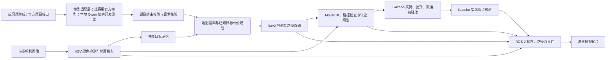

# yzbot 比赛仿真：使用说明、原理与部署

**赛道名称：** 算法应用赛  
**赛题名称：** 大模型技术创新赛  
**参赛编号：** 待填写  
**团队名称：** 待填写  
**团队成员：** 待填写

> 正式比赛使用比赛平台/组委会提供的模型。本地 Qwen 只作开发测试，不是比赛模型；GitHub 源码包不含 Qwen 权重及本地推理程序。

本文是可随工程副本转交的主说明，包含使用方法、运行原理、部署步骤和后续官方模型接入说明。命令均从包含 `start.sh` 的项目根目录执行，不依赖特定用户账户或本机绝对路径。当前验证环境采用 Linux 图形桌面，Gazebo Classic 与 ROS 2 Humble 运行在 Ubuntu 22.04 容器中。

## 1. 快速启动

### 首次部署

```bash
git clone https://github.com/necx26/the-model-innocation.git
cd the-model-innocation
# 先按第 6 节安装 Docker/containerd；构建可能需要较长时间
./build.sh
```

### 本地比赛练习模式

进入解压后的项目目录，在终端执行：

```bash
./competition-start.sh
```

它会启动项目自带的隔离 Docker/containerd 数据目录、Ubuntu 22.04 + ROS 2 Humble 容器、Gazebo 比赛世界、Nav2、MoveIt 执行节点、本地练习模型服务和浏览器观察台。此脚本当前属于开发练习入口，会运行本地出题器和本地 Qwen；**没有接入官方模型前，不得把它当正式比赛启动方式**。观察台地址：<http://127.0.0.1:8765>。若浏览器没有自动打开，在同一台运行仿真的电脑上手动访问此地址。

### 官方模型适配模式

```bash
# 模式切换前先 ./stop.sh
YZBOT_TASK_MODE=official ./competition-start.sh
```

此入口启动仿真和观察台，不启动本地 Qwen，不自动生成练习题。默认适配器是明确报错的待实现模板；未接入官方资料前不能执行正式任务。模型接入和题目提交见第 5 节。

### 常规仿真模式

在项目目录运行：

```bash
./start.sh
```

该模式启动常规 Gazebo 世界、MoveIt RViz 与 Nav2 RViz，不启动比赛观察台和本地 Qwen。

### 桌面快捷方式

构建完成后可执行 `./install-desktop-shortcut.sh`，在当前用户桌面创建普通 Gazebo 仿真和比赛观察台快捷方式。比赛快捷方式默认是开发练习，需要另配测试模型；官方模式按终端环境变量启动。

### 关闭和重启

```bash
./stop.sh
./competition-start.sh
```

第一条关闭仿真容器、项目专用的 Docker 后台进程和本地练习模型；第二条重新启动比赛练习。`stop.sh` 不删除工程和日志。启动需要当前用户有图形桌面访问权限及启动 Docker/containerd 所需的管理员权限。

## 2. 开始一轮练习

1. 等待 Gazebo 场景和观察台加载完成；状态显示“等待开始随机任务”。
2. 点击“多隔间随机重置”。它会复位机器人、打开夹爪，并把红蓝各 5 个方块混合散布到地图的七个可达分区，包含挡板后方区域。各颜色没有固定取货点。
3. 等状态显示“方块已随机摆放，场景已重置，可开始新一轮”。随机种子和每个方块坐标记录在 `logs/random-layout.json`。
4. 点击“开始随机任务”。当前练习版由本地题目生成器出题，并调用本地测试模型解析，再由程序校验结果后执行。计时上限为 300 秒。正式比赛模型由组委会/平台提供，正式版必须按官方接口接入该模型，不能把本地 Qwen 当作比赛模型。
5. 观察状态、规划路径、前置识别画面、两路固定机位和任务事件。每件物品的抓取抬升和放置落点会记录在状态及日志中。

正在执行时，“停止作业”会取消当前任务。重新开始前先点击“随机重置”。正式比赛开始前应关闭练习题生成和本地模型调用，接入官方题目与模型服务。

为对比调试，可用 `POST /api/reset?seed=20261018` 复现布局；同一布局种子也对应相同练习题。普通按钮每次生成新种子。当前场景采样范围为 `x∈[-7,6.5] m、y∈[-5.5,6] m`，地图分区由可通行路径自动划分；摆放点要求离障碍足够远、有可行抓取接近位姿，物体间距大于 0.65 m。正式场景变更后，应更新地图、搜索范围和官方允许的摆放规则。

## 3. 相机与机位

当前仿真有三路不同用途的画面：

| 画面 | ROS 2 图像话题 | 用途 |
|---|---|---|
| 机器人前置相机 | `/camera/image_raw` | HSV 颜色识别和抓取定位；安装在机器人上，会随车移动 |
| 高位固定全景 | `/fixed_overview/image_raw` | 从场地上方观察整个作业区 |
| 斜侧固定全景 | `/fixed_oblique/image_raw` | 从场地内侧观察底盘和机械臂动作 |

两路固定画面以 640×360、5 FPS 发布，可在观察台“固定机位画面”区域查看。比赛规则的线上双机位规定为：机位一拍摄比赛现场，机位二录制电脑控制系统界面。这里新增的两路 Gazebo 固定视角用于仿真观察；正式参赛时仍应按组委会要求布置现场相机和电脑录屏。

## 4. 工作原理



- **Gazebo** 提供原 yzbot 底盘、六轴机械臂、传感器、工作区和移动障碍的物理仿真。比赛世界中保留的是提供工程里的机器人外形和结构。
- **前置相机**输出真实 Gazebo 相机图像。颜色识别和目标坐标由图像、相机内参和 TF 计算；Gazebo 物体坐标主要用于确认识别对应的实体、检查抓取距离和核验最终落点。
- **Nav2**规划底盘从取货区到放置区的路径，并控制差速底盘。移动障碍按预设路线巡逻；规划地图对巡逻路线加入代价，引导机器人绕行。
- **MoveIt**根据抓取/放置目标计算机械臂逆解，执行碰撞检查、轨迹规划和关节控制。
- **夹爪仿真**通过 Gazebo LinkAttacher 在接近物体后建立固定关节，搬运到目标区后释放，再读取实际落点核验。这是仿真附着模型，不代表真实夹爪的摩擦抓取性能。
- **模型职责**：图像识别由机器人前置相机与颜色识别程序完成，语言模型只处理题意/任务结构。当前源代码里的本地题目生成器和 Qwen 调用用于开发、调试和本机练习；正式比赛题目、模型文件/服务和调用协议以组委会提供内容为准。练习模式会校验题目约束与执行计划，未通过校验的答案不会执行。
- **定位边界**：比赛练习模式用 Gazebo 世界真值里程计和静态 `map→odom` 对齐，不能据此宣称已经完成真实 SLAM 验收。普通 `start.sh` 模式保留 AMCL 流程。

### 分散目标的搜索与搬运策略

机器人边移动边用前置相机识别目标，将相同颜色、位置一致的连续观测融合成目标记忆。搜索和目标选择模块不读取随机布局文件或 Gazebo 物体真值；Gazebo 实体名称在抵近、相机复核后才用于附着与接触核验。固定观察相机只用于观察台，不参与找货。已搬运物体的颜色在运输期间会从发现流程中过滤，机械臂升降和释放期间暂停记录，避免把高于地面的货物误投影成新的地面目标。图像按自身时间戳匹配 TF，并使用短帧缓存等待对应变换。

没有足够目标时，在可达地图中选择观察点，以“新增可见采样区域 /（移动时间 + 环视时间 + 预期送达代价）”评分。墙会阻断可见性，距离采用膨胀地图上的八邻域 Dijkstra 代价，包含狭窄通道和巡逻车区域惩罚。观察点到达后只转向尚未看过的方向；相机一旦确认所需颜色，就结束搜索动作。行驶中也会记住之后需要的另一种颜色。

发现目标后，枚举每个物体的 16 个接近方向，检查停靠、抵近和转动空间；先到约 0.70 m 观察位置重新识别，再靠近到约 0.20 m 的抓取位置。用动态规划选择当前已发现目标的组合与执行次序，保持题目指定的颜色顺序和数量，并计入从当前位置到取货点、到放置区、转向和抓放的代价。单夹爪每次只搬一件；每次放置后根据新观测重新规划。

“最优”只针对已发现目标、当前地图和估计代价模型；未知目标位置、动态障碍等待和识别误差使实际全局最快无法预先保证。这里的改进是每轮在线发现、记忆和重规划，不改变语言模型权重。观察台的搜索覆盖率是地图采样点的可见覆盖估计，不等于所有地面都已完成识别。

## 5. 正式比赛模型与本地 Qwen 的区别

**正式比赛使用组委会/比赛平台提供的模型；本地 Qwen 只用于个人电脑上的开发测试。** 本地 Qwen 不作为正式比赛的模型提交、比赛推理服务或官方模型替代品。收到官方模型文件、SDK、服务地址或话题接口后，应依据官方说明接入，不能根据本机测试接口猜测官方协议。

### 本地开发服务（可选，不随 GitHub 工程分发）

本机曾使用 `qwen2.5-coder-0.5b-instruct-q4_k_m.gguf`，由用户提供的 yzbot 工程复制而来，原工程 `tools_demo/readme.txt` 列有 ModelScope 下载链接，作为来源线索保留；本机文件的实际下载来源未核验。该本机文件 SHA-256 为 `1d9614638d18024d0fbb36575a15f1302a3adf044df10345688ec4f6e1c4ff32`。权重、`llama-server`、共享库及本地推理运行目录均不上传。接收源码的人不需要使用相同 Qwen，正式模式与该服务独立。

如需复现本地练习，另行准备经过许可的 llama.cpp 兼容测试服务，需支持 `/health`、`/v1/chat/completions` 与 `response_format` 中的 JSON schema 约束，然后执行：

```bash
YZBOT_TASK_MODE=practice \
YZBOT_PRACTICE_LLM_URL=http://127.0.0.1:8081 ./competition-start.sh
```

如果本机已有 `competition/llm/` 的对应模型及 `llama-server`，默认练习入口可启动它们。源码接收者未配置服务时，练习入口会报错提示，不会下载或伪造模型。练习题的数量/顺序校验会使用生成器答案，只是本地调试机制；官方路径不使用该生成器或答案。

### 给后续 AI/开发者的官方模型接入步骤

1. 先向组委会取得官方模型包、SDK/API 文档、版本、模型运行依赖、题目来源和 ROS 2 话题/服务定义。本项目不假设官方采用 OpenAI 兼容协议。
2. 实现 `ros_ws/official_model_adapter.py` 中的 `solve_task(*, question, context, config)`。函数调用官方模型，完成解析及与原题的语义核验，再返回下列**项目内部控制结构**：

```json
{"red":2,"blue":3,"first":"red","red_zone":"B","blue_zone":"C"}
```

这不是官方 API 格式。`ros_ws/model_adapter.py` 检查字段及范围：红蓝数量为整数、各 0..5、总数 5、顺序为 red/blue、区域 A/B/C。其他题型、物体或总数需要扩展感知、结构校验和执行器。结构校验不能替代官方适配器对题目答案的语义核验。

3. 可用 `YZBOT_OFFICIAL_ADAPTER=your_module:your_function` 指定其他模块（放在 `ros_ws/` 中）；可选 `YZBOT_OFFICIAL_CONFIG=/home/ros/dev_ws/official-config.json` 从**容器内路径**加载 JSON 配置并传入 `config`。参考根目录 `model-config.example.env`。配置、鉴权密钥和官方模型资产不提交 Git。调用层默认等待 45 秒，可用 `YZBOT_OFFICIAL_TIMEOUT` 设置为大于 0 且不超过 240 秒；超时后本轮停止，后台推理线程不再驱动任务。适配器只能做推理，不得发送机器人动作，并必须设置 SDK/网络调用的有限超时和有限重试来释放其资源；输出无效或调用失败时抛出异常停止，不返回默认计划。新增依赖写入 Dockerfile，模型资产按官方要求单独挂载。
4. 以 `YZBOT_TASK_MODE=official ./competition-start.sh` 启动。由官方题目桥接程序向本地入口提交题目：

```bash
curl --noproxy '*' -X POST http://127.0.0.1:8765/api/task \
  -H 'Content-Type: application/json' \
  -d '{"question":"替换成官方完整原题","context":{"round_id":"example"}}'
# 也可点观察台的“执行已接收题目”
curl --noproxy '*' -X POST http://127.0.0.1:8765/api/start
```

`/api/task` 是本项目的本机桥接口，**不是官方协议**。官方 ROS 接口需按文档另外映射。运行时不能替换题目；没有收到题目时拒绝开始；默认模板未实现时明确停止，且不调用 Qwen。适配调用和 SDK 在 ROS 容器内运行。当前入口不自动启动外部官方模型服务，服务生命周期按官方部署要求另行配置。

5. 验收官方样例与实际 SDK/服务，记录模型版本、输入输出和结果，再进行完整比赛演练。当前交付已验证内部接口的字段校验、错误停止和自定义模块加载，**未验证官方模型兼容性或正式比赛成绩**，因为官方 SDK/模型/协议尚未提供。

## 6. 部署结构

- **主机要求**：Linux x86-64、有可用图形桌面与 X11/XWayland、Docker/containerd；启动脚本需要有权限启动项目专用 Docker/containerd。主机无需预装 ROS 2，ROS 环境在容器内。
- **运行容器**：Ubuntu 22.04、ROS 2 Humble、Gazebo Classic 11、MoveIt 2、Nav2、CycloneDDS。仿真容器名为 `yzbot-sim`，ROS 域 ID 为 `88`。
- **项目目录**：解压后的项目根目录就是启动脚本计算出的工作目录。`ros_ws/`、`competition/`、`logs/`、`docker-data/`、`containerd-root/`、`runtime-home/` 都相对放在该目录中。
- **源码**：`ros_ws/src/yzbot/` 为本项目运行副本。启动容器时映射为容器内 `/home/ros/dev_ws`；容器内该固定路径供 ROS 包和 Gazebo 插件解析，与主机用户名和目录无关。
- **本地开发模型**：本机可选的 `competition/llm/` 仅供练习，不随 GitHub 工程分发。官方模型通过独立适配器接入。
- **启动脚本**：`start.sh`（普通仿真）、`competition-start.sh`（按环境变量选择练习/官方适配模式）、`stop.sh`（关闭运行环境）。脚本根据自身位置找项目目录，不要求安装在特定用户目录。
- **观察台**：`ros_ws/competition_node.py` 和 `ros_ws/competition.html`；世界文件为 `ros_ws/src/yzbot/mybot_description/worlds/competition.world`。

### 首次部署或重新构建

主机需安装 Docker/containerd，并有活动图形桌面。Ubuntu 主机缺少这些命令时，可先安装：

```bash
sudo apt update
sudo apt install docker.io containerd runc
```

启动脚本以非交互方式启动项目专用后台，因此当前用户需有相应管理员授权。推荐在**项目根目录**运行 `./build.sh`：它先请求本机 sudo 授权、初始化专用后台、构建缺失镜像，然后编译工作区及插件。脚本会复用已有镜像；更改 Dockerfile 后需手动重新构建镜像。日常启动前如需 sudo 授权，执行 `sudo -v`；无需修改全局 sudo 配置。以下为等价的分步命令（先执行 `sudo -v; ./start.sh --daemon-only`）：

```bash
PROJECT_DIR="$(pwd)"
docker -H "unix://$PROJECT_DIR/docker.sock" build \
  -t yzbot-humble:local \
  -f "$PROJECT_DIR/docker-build/Dockerfile" "$PROJECT_DIR/docker-build"
```

再用临时容器构建 ROS 工作区和巡逻插件：

```bash
PROJECT_DIR="$(pwd)"
docker -H "unix://$PROJECT_DIR/docker.sock" run --rm --network host --ipc host \
  --user "$(id -u):$(id -g)" -e HOME=/home/ros -e ROS_DOMAIN_ID=88 \
  -v "$PROJECT_DIR/runtime-home:/home/ros" \
  -v "$PROJECT_DIR/ros_ws:/home/ros/dev_ws" -w /home/ros/dev_ws \
  yzbot-humble:local bash -lc 'source /opt/ros/humble/setup.bash && \
    colcon build --symlink-install \
      --packages-select linkattacher_msgs ros2_linkattacher mybot_description mybot bot_navigation \
      --cmake-args -DBUILD_TESTING=OFF && \
    cmake -S src/yzbot/Move_Obs -B src/yzbot/Move_Obs/build && \
    cmake --build src/yzbot/Move_Obs/build -j2'
```

巡逻插件在场景文件中使用容器内固定路径 `/home/ros/dev_ws/src/yzbot/Move_Obs/build/libcompetition_patrol.so`，因此需要在该工作区路径下构建。完成构建后，接好模型再选择练习或官方适配模式启动。仅观察普通仿真可运行 `./start.sh`，无需模型。日常启动不需要重复构建。

## 7. 后续 AI 接手的源码位置与改动边界

| 文件/位置（相对项目根目录） | 内容 |
|---|---|
| `ros_ws/competition_node.py`：`llm_task()` / `practice_task()` | 按模式分流；官方输入与练习生成器隔离 |
| `ros_ws/official_model_adapter.py` | 官方 SDK/模型调用实现入口，默认明确报错待实现 |
| `ros_ws/model_adapter.py` | 可配置适配器加载、内部任务结构校验 |
| `ros_ws/competition_node.py`：`vision()` 与搬运流程 | 前置图像识别、坐标投影、导航/机械臂协调、抓取放置核验 |
| `ros_ws/mission_strategy.py` | 地图通行代价、分区随机摆放、遮挡可见性、图像目标记忆、搜索评分和已知目标动态规划 |
| `competition/test_distributed_strategy.py` | 挡板绕行、七区随机布局、目标记忆隔离和任务顺序检查 |
| `ros_ws/competition.html` | 浏览器观察台、三路图像显示、进度和操作按钮 |
| `ros_ws/src/yzbot/mybot_description/worlds/competition.world` | 比赛场景、货物、两辆巡逻车、两个固定观察相机 |
| `ros_ws/src/yzbot/mybot_description/urdf/originbot_with_rgbd_gazebo_arm.xacro` | 移动机器人前置识别相机和机械臂组合模型 |
| `ros_ws/src/yzbot/bot_navigation/param/competition_nav2.yaml` | 比赛练习用 Nav2 地图、底盘外廓和路径跟踪参数 |
| `ros_ws/src/yzbot/mybot/config/six_arm_full.srdf` 与 MoveIt 配置 | 底盘、机械臂联合模型的规划组和碰撞配置 |
| `ros_ws/src/yzbot/IFRA_LinkAttacher/ros2_LinkAttacher/src/gazebo_link_attacher.cpp` | 仿真抓取/释放插件 |
| `ros_ws/src/yzbot/Move_Obs/competition_patrol.cc` | 白色移动底盘巡逻模型的平滑运动插件 |

已修复/设置的关键点：前置相机升高并朝向取货区；目标坐标由相机图像和 TF 投影；导航控制参考点放在驱动轮轴心附近；驱动轮几何间距和支撑球摩擦经过修正；夹爪末端姿态使用单位四元数 `(0,1,0,0)`；目标点附近由机器人末端做精对准；固定相机话题为 `/fixed_overview/image_raw` 和 `/fixed_oblique/image_raw`。调整这些配置后，先按部署章节重建相应包，再启动仿真核对。

补充参数记录：前置相机由离地约 0.093 m 升至约 0.403 m，安装偏移 `y=0.16 m`、俯仰 `0.60 rad`、朝内偏转 `-0.35 rad`，输出 640×360、10 FPS；车体导航参考系为 `base_control`，驱动轮间距配置为 0.37 m；Nav2 使用 Regulated Pure Pursuit 和碰撞检测。比赛练习定位采用 Gazebo 世界里程计与静态 `map→odom` 对齐。两辆白色障碍车使用提供工程中的移动底盘模型和独立平滑巡逻插件。

**正式对接时保留感知和运动控制链，只替换题目来源、模型调用、官方结果映射和 ROS 接口适配。** 当前比赛节点的 HTTP 和 ROS 话题是本地观察台接口，不代表组委会定义的接口。官方接口资料未随当前工程提供；拿到资料后，以官方 schema/topic/service 为准增加映射层，不能将下面的练习接口直接宣称为官方兼容。

## 8. ROS 2 与练习观察台接口

比赛后端发布 `/competition/task`、`/competition/status`、`/competition/detections`、`/competition/events`、`/competition/path` 和 `/llama_command`。图像话题见上方相机表。浏览器观察台只监听本机 `127.0.0.1:8765`，主要接口如下：

| HTTP | 用途 |
|---|---|
| `GET /api/state` | 当前题目、进度、机器人和场景状态 |
| `GET /api/image` | 机器人前置相机 JPEG |
| `GET /api/camera/overview` | 高位固定机位 JPEG |
| `GET /api/camera/oblique` | 斜侧固定机位 JPEG |
| `GET /api/map` | 观察台地图底图 |
| `POST /api/task` | 官方适配模式接收 `{question, context}`；本机桥接入口 |
| `POST /api/start` | 开始 300 秒任务（来源由启动模式决定） |
| `POST /api/reset?seed=整数`（seed 可省略） | 复位并随机摆放场景 |
| `POST /api/stop` | 停止当前动作 |

## 9. 已验证结果与交付边界

2026-10-18 的分散摆放测试：红蓝各 5 个物体散布在七个地图分区；任务取红 3、蓝 2，先蓝后红，红放 A、蓝放 C。机器人用前置图像搜索，没有把随机布局坐标作为搜索输入。

| 版本 | 布局种子 | 实际抓取 / 放置 | 用时 | 限时 |
|---|---|---|---|---|
| 分散搜索首次跑通 | 20261018 | 5/5、5/5 | 296.5 秒 | 300 秒 |
| 减少无效环视、搜索考虑送达代价 | 20261018 | 5/5、5/5 | 281.5 秒 | 300 秒 |

同一布局和题目下减少 15.0 秒。只验证了这一分散种子的两次完整运行，不能据此宣称多种子成功率、未知场景全局最优或正式比赛通过。抓取抬升事件和实际落点核验在 [分散场景验证记录](distributed_debug_seed_20261018/report.md) 及同目录 JSON 中。

更早的简单取货布局记录为 245.6 秒、5/5；它的目标集中，不能用作七区搜索的成绩。见 [早期练习记录](mock_exam_seed_2949820153/report.md)。

新增两路固定相机已检查图像发布，均约 5 Hz。官方适配模式已做“无题拒绝开始、提交题目、未配置适配器明确停止”检查，停止前未搬运物体；练习解析与运动控制路径保持独立。离线检查可运行：

```bash
python3 -m unittest discover -s competition -p 'test_distributed_strategy.py' -v
python3 -m unittest discover -s competition -p 'test_model_adapter.py' -v
```

这是本地 Gazebo 练习成绩，不是官方比赛成绩。正式比赛必须对接平台提供的模型、官方出题与 ROS 接口；这些材料尚未包含在工程中。真实 SLAM、真实硬件抓取、不同随机布局的稳定性及按要求布置现场机位/电脑录屏仍需验收。按已提供的规则，省赛交付物包括**算法源码压缩包、技术文档和比赛视频**；本 README 可作为技术说明基础，首页的编号、团队和成员需自行填写。当前未制作比赛视频。

## 10. 工程交付与清理

GitHub 交付包含源码、地图、原机器人和世界资产、Gazebo 插件源码、构建与启停脚本、官方适配模板、检查脚本和少量验证记录。保留依赖源码原有许可证；来源说明见根目录 `THIRD_PARTY_NOTICES.md`。不包含 Qwen 权重、本地推理程序、官方模型、密钥、Docker 镜像/运行数据、编译产物和大批临时日志。接收者应按第 6 节重新构建。

所有项目运行数据默认生成在工程目录内；先 `./stop.sh`，确认没有需要保留的结果后可删除整个工程目录。主机安装的 Docker/containerd/GitHub CLI 等系统软件由包管理器管理，不随删工程自动移除。专用 Docker/containerd 初始化需要 sudo，宿主图形显示依赖活动 X11/XWayland 会话；不同主机的图形授权和图像性能需当地验证。
